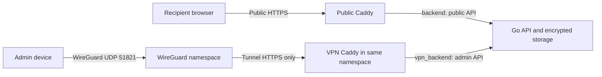

# vault.miszori.dev

A self-hosted application for sharing client-encrypted files, folders, and plain-text secrets through one-time or time-limited links. Content is encrypted and decrypted in the browser; the server stores ciphertext and does not receive decryption keys.

Administration is restricted to a WireGuard VPN and requires application sign-in. Recipients use the public HTTPS site without a VPN or account. The application runs as a Go API, two Caddy proxies, and a WireGuard service, with no database service, frontend framework, third-party scripts, analytics, or frontend build step.

> **Important:** A one-time package is consumed when an authorized download or reveal begins, even if delivery fails. Opening a link or fetching its preview does not consume it. Client-side encryption does not protect future sessions if the server is compromised and serves modified JavaScript.

## Contents

- [Features and limits](#features-and-limits)
- [Deployment](#deployment)
- [Usage](#usage)
- [Architecture and encryption](#architecture-and-encryption)
- [Security and privacy](#security-and-privacy)
- [Development and testing](#development-and-testing)
- [Operations and maintenance](#operations-and-maintenance)

## Features and limits

- **Two availability modes:** one-time access, or repeated access until expiry or administrator deletion.
- **Encrypted file and text sharing:** file packages download as one ZIP archive; text secrets are revealed directly in the browser.
- **Private administration:** VPN-only uploads, encrypted admin-only package names, and paginated retrieval activity.
- **Streaming transfers:** files are encrypted in chunks and decrypted into ZIP/ZIP64 archives without whole-file buffering on supported browsers.

| Limit | Value |
| --- | --- |
| File package size | 20 GiB |
| Files per package | 20,000 |
| Active packages | 100 |
| Plain-text size | 8 MiB of UTF-8 bytes |
| Expiration | 1 minute–30 days, including upload time |
| Encryption chunk size | 8 MiB |
| Aggregate ciphertext quota | 100 GiB by default; configurable |
| Audit retention | Until 90 days after package expiry |

ZIP entries use the uncompressed store method and preserve file paths, including nested and Unicode names. Empty folders are not preserved. ZIP64 supports files and archive offsets above 4 GiB; use a current ZIP utility for large archives.

## Deployment

### Prerequisites

- A Linux host with kernel WireGuard and IPv4/IPv6 netfilter support.
- Docker Engine with Compose v2.
- A public domain, DNS control, and inbound TCP 80/443 plus a WireGuard UDP port.
- Sufficient disk space for ciphertext, audit metadata, and other host workloads.

WireGuard requires `NET_ADMIN` inside its container namespace, not privileged mode, host networking, a Docker socket, or `SYS_MODULE`. Install any missing kernel support on the host before deployment; the container fails closed if it is unavailable.

The Compose project is named `vault-miszori-dev`. Use fresh named volumes for an initial deployment, and check for port and subnet conflicts without modifying other projects. The default backend ranges are `172.30.0.0/25` and `172.30.0.128/25`; keep Docker, tunnel, host, and client LAN networks non-overlapping.

### 1. Configure DNS and ingress

Point the domain's A record to the server. Publish an AAAA record only after configuring IPv6 listeners and firewall rules; the supplied deployment binds IPv4 addresses.

| Interface | Port | Purpose |
| --- | --- | --- |
| Host `PUBLIC_BIND_IP` | TCP 80/443 | Public HTTPS, redirects, and ACME |
| Host `PUBLIC_BIND_IP` | UDP `WIREGUARD_PORT` (default 51821) | WireGuard transport; container port 51820 |
| Tunnel `VPN_BIND_IP` (default `10.13.13.1`) | TCP 80/443 | VPN-only admin HTTPS and redirect; no host-published TCP port |
| Docker backend networks | TCP 8080/8081 | Public/admin API listeners; no host-published ports |

If the server is behind NAT, forward these public ports to its local interface address. Do not publish extra admin TCP ports or forward the tunnel IP. Enforce ingress policy at the upstream firewall as well: Docker forwarding can bypass ordinary UFW rules.

### 2. Configure the environment

Create a private environment file from [`.env.example`](./.env.example) and generate an enrollment token:

```bash
cp .env.example .env
chmod 600 .env
openssl rand -hex 32
```

| Variable | Configuration |
| --- | --- |
| `DOMAIN` | Public hostname; defaults to `vault.miszori.dev` |
| `ACME_EMAIL` | Email for public certificate issuance |
| `PUBLIC_BIND_IP` | A specific IPv4 address assigned to the host; use its LAN address behind NAT, never `0.0.0.0` or the router's external address |
| `ADMIN_SETUP_TOKEN` | Generated one-time enrollment token, at least 32 characters; **not** the admin password |
| `ADMIN_USER` | Single administrator username; defaults to `admin` |
| `WIREGUARD_ENDPOINT` | Public DNS name or IP, without a scheme or port |
| `WIREGUARD_PORT` | Public UDP port; defaults to `51821`; must match firewall/NAT rules |
| `WIREGUARD_PEERS` | Distinct comma-separated alphanumeric device names; defaults to `admin`, for example `laptop,phone` |
| `WIREGUARD_SUBNET` | Non-overlapping IPv4 `/24`; defaults to `10.13.13.0/24` |
| `VPN_BIND_IP` | Server address inside that tunnel; defaults to `10.13.13.1`; do not assign it to the host |

No host VPN interface, extra VPN service, hosts-file entry, or DNS override is required. For storage and admission settings, see [Resource controls](#resource-controls).

### 3. Start the services

```bash
docker compose config --quiet
docker compose up --build -d --wait
docker compose logs --tail=30 wireguard api caddy caddy-vpn
```

WireGuard generates persistent device identities. The VPN proxy waits for tunnel health before binding. Public Caddy obtains an ACME certificate using the configured domain and inbound access; VPN Caddy uses a separate internal certificate authority for the private tunnel address.

### 4. Enroll an admin device

Export the device profile and the VPN CA's **public root certificate** through a trusted local channel. Replace `admin` with the configured peer name if needed.

```bash
install -d -m 700 ./vpn-export
docker compose cp wireguard:/config/peers/admin/admin.conf ./vpn-export/admin.conf
docker compose cp caddy-vpn:/data/caddy/pki/authorities/local/root.crt ./vpn-export/vpn-root.crt
chmod 600 ./vpn-export/*
```

Import the profile into the official WireGuard client and activate the tunnel. Independently verify the root certificate, then install it in the device or browser trust store. Export only the certificate, never the CA private key. HTTPS remains mandatory inside the VPN for WebCrypto and Service Workers; do not disable secure-context checks or bypass an unverified certificate warning.

Each profile contains a private key. Use one profile per device; never commit, publish, or paste it into chat. Delete exported copies after secure transfer. The default profile routes only `10.13.13.1/32`; other device traffic is unchanged, and server-side rules block forwarding to the LAN, Internet, Docker networks, and other peers.

### 5. Set up the administrator

Open **https://10.13.13.1/admin** through the tunnel, or substitute the configured `VPN_BIND_IP`. Enter the setup token and choose a different, strong password of 16–1,024 Unicode characters. The browser derives separate authentication and name-encryption keys; the password itself is not sent to the API.

Enrollment is one-time. The setup token cannot reset an enrolled password and may be removed from the environment after enrollment. Preserve the `packages` volume, including `auth.json` and `label-salt`. Subsequent sign-ins use the chosen password. This is a single-admin application; WireGuard device authentication is not MFA.

Both public and VPN `/` redirect to **https://gergo.miszori.dev**. Use `/admin` explicitly; recipients use generated package URLs.

### 6. Verify access boundaries

```bash
docker compose ps
docker compose exec wireguard wg show wg0
```

A connected device should show a recent handshake. Verify that:

- Outside the VPN, public `/admin`, `/admin/api/packages`, and `/api/admin/packages` return 404, and the tunnel admin URL is unreachable.
- Through the VPN, the admin page loads over trusted HTTPS and sign-in works.
- Public recipients can retrieve a test package without WireGuard.

Container health confirms local service readiness, not remote reachability. If no handshake appears, check endpoint DNS, UDP ports, firewalls, and NAT. If the tunnel connects but administration fails, check peer routes, subnet overlap, VPN Caddy logs, and certificate trust.

## Usage

### Create and share a package

1. Connect to WireGuard and sign in at the admin URL.
2. Choose files or a folder, or select **Format → Plain TXT** and enter a multiline secret.
3. Select an availability mode and expiration. Use a preset or **Choose date and time**, which uses the device's local time. Expiry starts at package creation, **including upload time**; allow enough time for large transfers.
4. Optionally add a private package name, then start encryption and upload. Keep the tab open until the share link is ready.
5. Copy the complete link and send it through a trusted, preferably end-to-end-encrypted channel.

The link contains the package ID in its path and the decryption key after `#`. URL fragments are not sent in HTTP requests, but a messaging provider receiving the complete link can read the key in the message. The server cannot recover a lost key or reconstruct the full link; create a new package if it is lost.

### Choose an availability mode

| Mode | Recipient action | Lifetime and failure behavior |
| --- | --- | --- |
| **One-time** (default) | Confirm the warning, then download or reveal | Exactly one authorized claim; ciphertext is deleted during/after the attempt, including failed or interrupted delivery. No retry or recovery. |
| **Available until expiry** | Download or reveal without a destructive-action warning | Repeated retrievals until expiry or deletion. Interrupted downloads can restart from the beginning, but cannot resume. |

The mode is fixed at creation. Older packages and omitted API mode values default to one-time. Opening a link, checking availability, or fetching a messaging preview does not claim a package or create a retrieval audit entry. Both modes require proof derived from the link's key.

Expiry and deletion immediately prevent new retrievals. Already-admitted reusable downloads may finish; their ciphertext remains allocated until active readers close and cleanup completes. Expired packages are unavailable immediately, independently of the 15-second cleanup sweep.

### Retrieve files or text

For files, the recipient opens the original link, chooses a destination where supported, and explicitly starts the download. The browser decrypts the package locally into one ZIP archive.

For text, **Reveal secret** decrypts into a read-only multiline field. **Copy secret** uses the clipboard when permitted, or selects the text for manual copying. Text is rendered literally, never executed as HTML, and does not create a ZIP or file download. One-time text is consumed when revelation starts, so copy it before leaving.

The page removes the key fragment from the current address/history entry after capturing it. Keys and decrypted text remain in tab memory; reloading requires reopening the original link. Text is cleared on leaving or initializing another package. The admin text editor is also cleared after upload, on leaving/sign-out, and when switching back to files. Copies retained by recipients or clipboard tools cannot be revoked.

### Private names and retrieval activity

Optional package names are visible only to the administrator and unlock at sign-in. Add a name during creation or use a package row's controls to rename or remove it. Names are encrypted separately from content and are absent from share links, recipient pages, archives, and previews. Signing out, leaving, or an authentication failure clears the name key and displayed names; reloading requires signing in again.

**Activity (count)** opens a paginated history of authorized retrieval starts, with up to 100 entries per page. It includes time, source IP, and reported browser, OS, and device details, including interrupted attempts. Closing the dialog or signing out clears displayed audit details. A `consumed` state means the server completed its response, **not** that the recipient successfully saved, extracted, or read it; `failed` includes interrupted uploads and aborted downloads.

Activity persists until 90 days after package expiry, including after deletion. Audit-write failures prevent ciphertext delivery. Browser/device details come from bounded User-Agent and low-entropy client-hint headers, which can be absent or forged; they are not proof of identity, hardware model, or location. No fingerprinting, geolocation, or persistent device identifier is used. Disclose this metadata collection to recipients and monitor audit disk usage separately from ciphertext quotas.

### Browser support and large downloads

Use trusted HTTPS, sufficient destination space, and a filesystem that supports files above 4 GiB; FAT32 is unsuitable for large archives. Desktop Chrome/Edge's File System Access API is preferred. Other compatible browsers use a same-origin Service Worker to stream into the native download mechanism without buffering the entire archive.

The worker is checked before a claim and uses a random, single-use local download route with backpressure. It receives ZIP bytes, not the key, does not upload plaintext, and does not cache files or keys in browser storage. It does not intercept unrelated routes or replace active transfers during updates.

If streaming is unavailable, the in-memory Blob fallback is limited to **128 MiB**. A failed worker preparation stops before claiming and requires renewed consent for fallback. Use working streaming support for large or unknown-size packages. Browser policies, Safari/iOS restrictions, private/embedded browsers, background suspension, and OS limits vary; a 10–20 GiB save is not guaranteed on every device. Keep the tab open and the device awake. Downloads cannot resume, and successful server delivery does not prove a successful local save.

### Messaging previews

Previews use one generic 1200×630 banner, with no package names, filenames, keys, contents, audit details, or package-specific availability. Preview requests do not consume packages. Image URLs use the configured public origin rather than request headers or VPN addresses; no canonical or `og:url` replacement is emitted, so clients can retain the original fragment-bearing link.

Messaging services may crop or cache the artwork, including after package deletion. Their access to the full message is separate from HTTP preview behavior: **a complete link still shares the decryption key with its recipients and messaging provider**. The application does not submit share links to external preview/debugging services.

## Architecture and encryption

### Services and network isolation

[compose.yaml](./compose.yaml) defines four services:

| Service | Responsibility |
| --- | --- |
| `caddy` | Public HTTPS and ACME, recipient assets, and public API proxying via [`Caddyfile`](./Caddyfile) |
| `wireguard` | Admin-only encrypted tunnel, persistent per-device identities, and forwarding restrictions |
| `caddy-vpn` | Admin HTTPS using an internal CA; shares WireGuard's network namespace, but not its keys or configuration volume, via [`Caddyfile.vpn`](./Caddyfile.vpn) |
| `api` | One Go process managing authentication, ciphertext, package state, quotas, audit records, and cleanup |



Public Caddy joins `edge` and internal `backend`; it cannot access the private backend, WireGuard keys, or VPN CA. WireGuard joins `vpn_ingress` and internal `vpn_backend`; the ingress bridge permits UDP port publishing. VPN Caddy binds only the tunnel IP. Both proxies share headers and upstream settings from [`Caddyfile.common`](./Caddyfile.common).

The API has separate public (`172.30.0.2:8080`) and admin (`172.30.0.130:8081`) listeners. The public handler rejects admin routes even with valid credentials. The admin handler requires the actual socket peer to equal `ADMIN_PROXY_IP` (`172.30.0.131`) as well as application authentication. Forwarded headers cannot satisfy that peer check. This is interface isolation, not process isolation against an API compromise.

Public requests to unknown hostnames or an IP address are aborted, or fail TLS negotiation. Hostname checks are not authentication. Do not attach unrelated containers to backend networks or add a CDN/external reverse proxy without redesigning client-IP reporting and trust boundaries.

#### Changing listener addresses

Change static Docker addresses, `PUBLIC_LISTEN_ADDR`, `ADMIN_LISTEN_ADDR`, `ADMIN_PROXY_IP`, both Caddy upstreams, and `TRUSTED_PROXY_CIDR` together. The trusted CIDR must be private IPv4 between `/24` and `/32`; it controls forwarded client-IP trust, not admin authorization. Avoid the multi-network `api` DNS name as an upstream because it can resolve to either interface.

Outside Compose, defaults are `127.0.0.1:8080` (public), `127.0.0.1:8081` (admin), and `127.0.0.1` (admin proxy). Wildcard and hostname listener bindings are rejected. Startup and health checks require both listeners; shutdown drains them concurrently. Connection caps apply per listener, while request and transfer admission limits are shared.

### Package lifecycle and protocol

1. **Allocation:** the server creates a random 256-bit package ID and a separate upload token. Authenticated uploads require that token; only its SHA-256 hash is persisted, then cleared at finalization.
2. **Encryption:** the browser generates a fresh random AES-256 key per package and encrypts the manifest and data records sequentially. Failed or ambiguous uploads are aborted rather than re-encrypted with reused IVs.
3. **Finalization:** the API verifies the record inventory and stores a hash of a key-derived claim proof. The browser produces `https://vault.miszori.dev/package/<package-id>#<base64url-key>` using the configured public domain.
4. **Claim:** an explicit recipient action sends a derived proof, not the decryption key. After proof validation and resource admission, the API durably records the retrieval start. A one-time claim atomically changes `ready` to `consuming`; concurrent claims cannot consume it twice.
5. **Delivery:** the response is a sequence of 4-byte big-endian ciphertext lengths followed by ciphertext records. For one-time packages, each record is unlinked before streaming, and remaining ciphertext is removed on completion or failure. Reusable packages retain ciphertext until expiry/deletion and completion of active reads.
6. **Local decoding:** the browser authenticates records and validates manifest, order, size, and paths. File data becomes a streaming ZIP/ZIP64 archive; text requires valid UTF-8 and a complete, correctly bounded stream before display.

Record 0 for files is a version-1 JSON manifest containing `files` entries (`path`, `size`, `lastModified`) and `chunkSize:8388608`. Data follows in manifest order, split into 8 MiB chunks; empty files need no data record. Text packages use exactly two records: a manifest with `version:1`, `format:"text"`, UTF-8 byte `size`, and `chunkSize:8388608`, followed by the text bytes. The server knows the format and availability mode but does not interpret encrypted contents.

Every record uses AES-256-GCM with a 128-bit tag. The 96-bit IV is four zero bytes followed by the unsigned 64-bit big-endian record index; AAD is UTF-8 `packageID:recordIndex`. Unique indices and a fresh key prevent IV reuse. ZIP CRC-32 is for archive compatibility; AES-GCM provides authentication. Unsafe traversal paths and duplicate names are rejected, and archive metadata memory is bounded by manifest/file-count limits.

Claim proofs use HKDF-SHA256 with the raw 32-byte package key, UTF-8 package ID as salt, and info `vault.miszori.dev:package-claim:v1`. The resulting 32-byte token is sent as `X-Claim-Token` on a bodyless HTTPS POST. The API stores only SHA-256 of the decoded token as `claimHash`, never exposed in public metadata. An ID, stored verifier, or invalid token cannot claim, audit, or delete a package. Legacy packages without a valid verifier or using an older claim namespace must be recreated; there is no insecure fallback.

### Administrator authentication and private names

The browser derives a 256-bit root using PBKDF2-SHA256 with 600,000 iterations and a persistent random 16-byte salt. HKDF-SHA256 separates:

- `vault.miszori.dev:admin-auth:v1`: a 32-byte authentication value sent over HTTPS; the API stores only its SHA-256 verifier in `auth.json`.
- `vault.miszori.dev:admin-names:v1`: a non-extractable AES-256-GCM key used only in the browser.

Each private name uses a fresh random 12-byte IV, a 128-bit tag, and AAD `vault.miszori.dev:admin-name:v1:<package-id>`. Only version, IV, and ciphertext are stored; ciphertext length can reveal approximate name length. Authentication values do not reveal the name key, and stored verifiers cannot authenticate, but a stolen salt/verifier permits offline password guessing. Use a strong, unique password.

Preserve `label-salt` and `auth.json`. Losing the password makes existing private names unrecoverable, not package contents, which use independent share-link keys. Names from the older separate-passphrase scheme have no migration/recovery UI and must be renamed. Sessions, passwords, keys, names, and plaintext are held in tab memory rather than browser storage.

### Persistent state

| Named volume | Contents |
| --- | --- |
| `packages` | Ciphertext, package/audit metadata, `auth.json`, and `label-salt` |
| `caddy_data`, `caddy_config` | Public certificate and Caddy state |
| `caddy_vpn_data`, `caddy_vpn_config` | Private CA, VPN certificates, and Caddy state |
| `wireguard_config` | Server/device identities and address reservations |

Each package directory contains numbered ciphertext `.bin` files and `meta.json`: state, timestamps, IP/browser details, optional encrypted name, claim verifier, byte/record counts, and the upload-token hash while uploading. Writes are synced and atomically renamed. Retrieval logs are separate from ciphertext; metadata and logs remain until 90 days after expiry.

Startup reconciles state and removes incomplete uploads, interrupted one-time claims, and revoked ciphertext before accepting requests. Ready, unexpired packages survive restarts. **Run exactly one API replica**: claim and admission locks are in-process.

## Security and privacy

### Trust boundaries

**Client-side encryption does not defend against a compromised server serving modified JavaScript.** Protect deployment credentials, review changes, and keep dependencies patched. An independently distributed client is needed if server-delivered code must be excluded from the trust model. No independent external security audit has been performed; automated vulnerability scans are not an audit or a security guarantee.

- **Share links grant access.** Anyone holding the complete link can retrieve the content. A package ID or stored claim verifier alone cannot authorize a claim. One-time content cannot be restored after an authorized attempt fails, including network, decryption, or save failures. Retain a trusted original for irreplaceable data.
- **Metadata remains visible.** The server learns ciphertext sizes and record boundaries, transfer timing, expiry, package format/mode, and retrieval IP/browser details. IPs may represent a proxy, NAT, or VPN; size patterns may reveal approximate file counts and sizes.
- **Delivered plaintext cannot be revoked.** Recipients, extensions, clipboard managers, messaging providers, screenshots, and endpoint malware are outside the application's control.
- **Deletion is not forensic erasure.** Unlinking files does not erase SSD remnants, snapshots, backups, RAID copies, or host caches. Exclude the package volume from backups/snapshots when destruction is required. Storage failures can prevent deletion, and offline storage cannot enforce real-time expiry; monitor cleanup errors.
- **Host access remains privileged.** Docker does not protect against a malicious host administrator. Protect the initial setup token and Docker access; use encrypted disks, encrypted/disabled swap, and disabled core dumps.
- **Avoid additional data collection.** Caddy access logging is disabled. Do not add request-body logging, key/URL telemetry, analytics, external error collection, or third-party scripts.

HTTPS protects transport, AES-GCM protects stored content, and the VPN/interface boundary restricts administration. CSP, same-origin checks, cache restrictions, and throttling provide additional safeguards, not absolute protection. Host patching, firewall policy, access-layer MFA where applicable, backup policy, and independent review remain operator responsibilities.

### Runtime safeguards

- Claim proofs and capacity are checked before state changes or ciphertext deletion. HTTP 429 responses occur before consumption, allowing retry with the original link.
- Global/per-IP request and authentication-failure budgets accompany nonblocking request/upload/download admission. VPN authentication discovery/setup has a separate budget from public package traffic. Authenticated chunk uploads are exempt from the public per-minute budget; valid credentials are not rejected solely because the global failure budget is exhausted. These controls are not DDoS protection.
- The API runs as UID/GID 10001 in a shell-free `scratch` image, with a read-only root, dropped capabilities, `no-new-privileges`, resource caps, and an internal `/vault healthcheck` command.
- Both Caddy services retain only `NET_BIND_SERVICE` and `no-new-privileges`; the management API is disabled. Keep that capability: the pinned binary's file capability otherwise causes Linux startup to fail with `operation not permitted`.
- Proxies limit header size/read time, idle time, and upstream connections. Error logs strip claim/upload/authentication/cookie credentials; container logs rotate at 10 MiB × 3 per service.
- Base images and Caddy are digest-pinned; WireGuard tools use Alpine's signed repositories. GitHub Actions are SHA-pinned with read-only permissions and no retained checkout credentials. CI checks Go source and the exact production binary with `govulncheck`, plus race/static, browser, and Docker/WireGuard tests. Review Dependabot proposals and Caddy digest updates; pins do not replace rebuilding and vulnerability monitoring.

Slow request bodies and individual response-record writes have two-minute I/O deadlines. Advancing downloads have no fixed overall duration limit, but cannot resume. Keep backend networks private and health checks local.

### Resource controls

| Environment variable | Default |
| --- | --- |
| `MAX_STORAGE_BYTES` | `107374182400` (100 GiB of ciphertext) |
| `MAX_CONCURRENT_REQUESTS` | `64` |
| `MAX_CONCURRENT_DOWNLOADS` | `4` |
| `MAX_CONCURRENT_UPLOADS` | `2` |
| `MAX_BACKEND_CONNECTIONS` | `128` per listener |
| `PUBLIC_REQUESTS_PER_MINUTE` | `600` per shared budget, with a fixed 120 per-IP limit |
| `AUTH_FAILURES_PER_MINUTE` | `60` globally, with a fixed 20 per-IP limit |

Values must be positive. Upload/download concurrency cannot exceed request concurrency, which cannot exceed backend connections.

The admin **Transfer activity** meter reports quota-counted ciphertext and the configured limit in decimal GB (1 GB = 1,000,000,000 bytes), refreshed with the package list. Uploading, ready, and active-download ciphertext count toward usage until cleanup releases it. Historical audit records do not count. This is neither total filesystem usage nor free disk space: audit logs and other workloads require additional headroom, especially for frequently retrieved reusable packages.

## Development and testing

### Repository layout

| Path | Purpose |
| --- | --- |
| [`cmd/vault/`](./cmd/vault/) | Go API, authentication, listeners, storage, claims, audit, and backend tests |
| [`web/`](./web/) | Static browser application, encryption, ZIP streaming, and browser-module tests |
| [`wireguard/`](./wireguard/) | VPN image, runtime configuration, and identity/persistence tests |
| [`tests/`](./tests/) | Disposable Docker stack, proxy/API integration tests, and real WireGuard peer tests |
| [`compose.yaml`](./compose.yaml), [`Dockerfile`](./Dockerfile) | Production topology and API image |
| [`Caddyfile`](./Caddyfile), [`Caddyfile.vpn`](./Caddyfile.vpn), [`Caddyfile.common`](./Caddyfile.common) | Public/private routing and shared proxy controls |
| [`.env.example`](./.env.example) | Deployment configuration template |
| [`.github/workflows/test.yml`](./.github/workflows/test.yml) | CI tests and vulnerability checks |
| [`tools/generate-preview.py`](./tools/generate-preview.py) | Optional generic artwork generator; requires Pillow, not used at runtime |

### Unit and standalone tests

Use Docker, Node.js 22+, and Python 3 for ZIP interoperability checks. Go need not be installed on the host; the commands below run it in disposable containers. Python is a test dependency, not an application runtime dependency.

```bash
# Backend unit tests/static checks inside Docker
docker run --rm -v "$PWD:/src" -w /src golang:1.26-alpine \
  sh -c 'go test ./cmd/vault && go vet ./cmd/vault'

# Race detector needs the C compiler only in this disposable test container
docker run --rm -v "$PWD:/src" -w /src golang:1.26-alpine \
  sh -c 'apk add --no-cache gcc musl-dev >/dev/null && CGO_ENABLED=1 go test -race ./cmd/vault'

# Browser-module tests
node --test web/*.test.mjs

# Standalone proxy capability/TLS/routing regression
node --test tests/proxy-isolation.test.mjs tests/vpn-tls.test.mjs

# WireGuard configuration, persistence and invalid-input tests
node --test wireguard/*.test.mjs

# Disposable production topology with a real WireGuard peer and admin TLS/API
node --test tests/wireguard.test.mjs
```

### Integration stack

Run the disposable loopback-only stack separately from production. Plain HTTP is suitable for WebCrypto on loopback only; never deploy the test configuration publicly.

```bash
docker compose -p vault-test -f tests/compose.yaml up --build -d --wait
node --test tests/*.test.mjs

# Remove only this test stack and its disposable data when finished
docker compose -p vault-test -f tests/compose.yaml down -v
```

While it is running, the admin UI is `http://localhost:18081/admin`; public links use `http://localhost:18080/package/...#key`. The bare root redirects to https://gergo.miszori.dev.

Tests automatically enroll username `admin`, password `integration-admin-password-with-zero-server-knowledge`, and setup token `integration-setup-token-never-deploy-1234567890`. **These fixed credentials are test-only and must never be deployed.** For manual first-setup testing, use the same values before the suite or start with a fresh disposable test volume.

The local stack uses `172.30.0.0/24`. Do not run it where that range is already allocated, including on the default production host. Choose a free private `/24` and update all test addresses together, leaving other projects untouched:

```bash
export TEST_PUBLIC_SUBNET=172.29.0.0/25 TEST_PRIVATE_SUBNET=172.29.0.128/25
export TEST_PUBLIC_API_IP=172.29.0.2 TEST_PRIVATE_API_IP=172.29.0.130
export TEST_ADMIN_PROXY_IP=172.29.0.131 TEST_TRUSTED_PROXY_CIDR=172.29.0.0/24
docker compose -p vault-test -f tests/compose.yaml up --build -d --wait
node --test tests/*.test.mjs
docker compose -p vault-test -f tests/compose.yaml down -v
```

The standalone WireGuard test uses its own disposable project and `172.28.0.0/24`; reserve that range when running the suite. It leaves other projects untouched. Fixtures retain production capability drops while permitting directory traversal on Linux; exported peer keys remain root-owned and owner-readable only.

### Large-transfer checks

With the integration stack running, these optional tests write a real archive and validate its entries with Python's independent ZIP reader:

```bash
# Real 20 GiB transfer and ZIP64 validation:
# requires >21 GiB free in Docker AND >21 GiB in the host temporary directory
LARGE_TEST_MIB=20480 node --test --test-name-pattern='optional large transfer' tests/integration.test.mjs

# Throttled transfer lasting about 165 seconds to check long-transfer deadlines
LARGE_TEST_MIB=192 SLOW_RECORD_MS=6500 node --test --test-name-pattern='optional large transfer' tests/integration.test.mjs
```

### Coverage and deployment checks

Backend tests cover authentication, listener boundaries, concurrent claims, quotas/admission, recovery, deletion/expiry, and transfer deadlines. Browser tests cover cryptographic derivation/framing, ZIP/ZIP64 interoperability, backpressure, text rendering, and lifecycle cleanup. Docker tests exercise real proxies/API, previews, encrypted file/text round trips, and public/admin isolation. WireGuard tests add an encrypted peer handshake, admin HTTPS/API access, forwarding rejection, and host-port checks.

Automated tests do not establish native save-dialog behavior on every browser, production ACME issuance, remote VPN reachability, or host firewall correctness. Verify these on the deployment and actual admin/recipient devices. Docker Desktop can run namespace/tunnel tests, but does not replace Linux deployment checks.

## Operations and maintenance

### Apply updates

Review code, image, and configuration updates before applying them. Retain named volumes:

```bash
git pull --ff-only
docker compose pull
docker compose up --build -d --wait

# Explicitly apply proxy configuration changes when needed
docker compose up -d --force-recreate caddy caddy-vpn
```

Check public retrieval and VPN admin access end to end after updates and host reboots. Keep exactly one API replica, monitor disk headroom, and investigate cleanup errors promptly.

### Manage VPN devices and recover admin access

For peer additions/removals, endpoint changes, or UDP-port changes, edit the environment, adjust firewall/NAT rules as needed, and recreate **both** namespace-sharing services:

```bash
docker compose up -d --force-recreate --wait wireguard caddy-vpn
```

**Independent WireGuard restarts require proxy recovery.** When `wireguard` restarts independently, including after a crash, Docker gives it a new network namespace. A running `caddy-vpn` can remain in the old namespace, breaking admin access even when WireGuard is healthy. Compose's `depends_on.restart` does not cover automatic container restarts. Recreate both services with the command above, reconnect the client, and verify admin HTTPS. Public downloads are unaffected; no Docker-socket-based auto-healer is provided.

Re-export changed profiles through a trusted channel; imported profiles do not update themselves. To revoke a device, remove its name from `WIREGUARD_PEERS` and recreate both services. Keys and address reservations persist across removal/reordering, so re-adding a name re-enables its old identity. Use a **new peer name** when replacing a lost or compromised device. A maximum of 253 addresses can be reserved; removed reservations are not reused.

Tunnel subnet/server-address changes require a new WireGuard configuration volume and device re-enrollment. Preserve identity and VPN CA volumes during normal maintenance; deleting them changes trust. Never publish profiles or server/CA private keys.

### Preserve and remove data

Restarting discards incomplete uploads and interrupted one-time claims. Ready, unexpired packages survive; reusable downloads can restart from the beginning. Audit metadata persists independently of ciphertext until its retention deadline.

`docker compose down` preserves named volumes. **`docker compose down -v` irreversibly removes packages, enrollment, audits, certificates, and VPN keys.** Do not use it for routine production maintenance.

### Administrator re-enrollment

There is no online password change/reset flow. Changing environment variables does not change an enrolled password or its name key.

Deliberate offline re-enrollment requires stopping the API, removing only `auth.json`, preserving `label-salt`, and supplying a new setup token. A different password cannot decrypt previous private names; existing package share links use independent keys and remain unaffected. Protect audit records as sensitive personal data and disclose their collection and retention.
