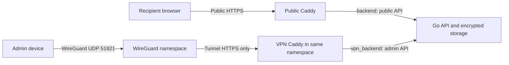

# vault.miszori.dev

Private, client-encrypted file and plain-text packages with one-time or expiry-based access. Both pages use a minimal black interface with blue controls, green Ready states, and red Unavailable/destructive-download warnings. The admin layout is capped at 1,100px and the narrower public shell at 900px, with no branding header; public package cards are centered in the viewport, with scrolling for taller content. Package links initially show only “Checking package availability”, then reveal the ready or unavailable view after validation. Docker runs a small Go API, separate public/private Caddy proxies, and WireGuard; the browser encrypts/decrypts with WebCrypto. No JavaScript frameworks, third-party scripts, analytics, database service, or build step for the web pages.

## What it does

- A **VPN-only admin page** creates packages from files or folders, sets an expiry, and displays download audit records. Its compact upload panel places expiry and optional private name side by side on desktop and stacks them on mobile. Destructive-download warnings remain on the recipient page, not the upload panel.
- For one-time packages, the public page displays a destructive-download warning. **Opening a link does not consume it**; clicking **Download package** does. This avoids previews and link scanners accidentally destroying packages.
- **One-time** is the default: a package can be claimed exactly once, including during concurrent requests. The server deletes its ciphertext during/after the attempt, even if the download fails. There is no retry or recovery for these packages.
- **Available until expiry** packages can be downloaded repeatedly by anyone with the complete link until expiry or admin deletion. Their recipient button says **Download**, with no destructive warning/checkbox. Interrupted downloads can be restarted (not resumed). Both modes require the key-derived claim proof before serving ciphertext.
- Unclaimed packages expire after 1 minute–30 days. Choose a preset duration or **Choose date and time** to select the expiration date, hour, and minute in your device's local time. Expiration includes upload time; the selected date is converted to seconds remaining when creation starts. The cleanup job runs every 15 seconds; expired packages are immediately unavailable even before cleanup runs.
- Up to **20 GiB per package**, 20,000 files, and 100 active packages. Encryption/upload uses 8 MiB records, not whole-file buffers. The default aggregate ciphertext quota is 100 GiB. Admin Transfer activity shows quota-counted ciphertext usage and the configured `MAX_STORAGE_BYTES` limit in decimal GB (1 GB = 1,000,000,000 bytes), refreshed with the package list. Uploading, ready, and in-progress downloads count toward usage; historical consumed/failed/deleted/expired records do not. Downloads retain their quota allocation until cleanup completes. This is not total filesystem usage or free disk space.
- Recipients download one **`.zip` archive**, preserving folder paths. ZIP64 supports files and archive offsets above 4 GiB. Entries use ZIP's uncompressed (store) method to keep large downloads streaming and avoid wasting CPU on already-compressed files. Use a current ZIP utility for very large archives.

## How the whole project works

### Processes and trust boundaries

[compose.yaml](./compose.yaml) runs four services:

1. **`wireguard`** establishes the encrypted, admin-only tunnel. Its UDP listener is the only published VPN port. Each device gets a separate private key and configuration. The tunnel is not a general-purpose router: forwarding to Docker networks, the LAN, Internet, or other peers is blocked.
2. **`caddy-vpn`** shares WireGuard's network namespace, not its keys or writable files. [Caddyfile.vpn](./Caddyfile.vpn) binds HTTP/HTTPS only to the tunnel IP. No admin TCP port is published on the host. It serves the admin application and proxies private API requests to the API's private Docker interface.
3. **`caddy`** serves the public hostname using [Caddyfile](./Caddyfile), obtains public ACME certificates, serves the recipient application, and proxies only public API traffic. It cannot access the private backend network, WireGuard keys, or the VPN CA. Both proxies import [Caddyfile.common](./Caddyfile.common) for headers and upstream settings.
4. **`api`** is one shell-free Go process. [listeners.go](./cmd/vault/listeners.go) separates public and administrative handlers by interface and checks the admin proxy's actual source IP. [main.go](./cmd/vault/main.go) owns package state, opaque ciphertext records, quota accounting, expiration, and cleanup. There is no database or server-side plaintext decryption.



### Administration and upload, step by step

1. Import a generated WireGuard profile into an admin device, connect, and open the tunnel's `/admin` URL over HTTPS. Trust only the independently verified VPN Caddy root certificate.
2. On first use, [auth.js](./web/auth.js) derives a root from the chosen password using PBKDF2-SHA256 and the server's persistent random salt. HKDF derives separate authentication and private-name keys. The one-time setup token authorizes enrollment; the API stores only a hash of the authentication value. Later requests send the derived authentication value over HTTPS, never the password or name key. [auth.go](./cmd/vault/auth.go) verifies enrollment and login.
3. [admin.js](./web/admin.js) asks the API to allocate a random package ID and upload token. The browser creates a fresh random AES-256 key. [crypto.js](./web/crypto.js) encrypts the manifest (including file paths) and file/text records with AES-GCM, binding every record to its package and index. Optional admin names are separately encrypted by [names.js](./web/names.js).
4. Encrypted records are uploaded sequentially. The API accepts them only with valid admin authentication and the package's upload token, applies size/admission/storage limits, and stores opaque numbered records. Finalization verifies the record inventory and stores a hash of a claim proof derived from the package key; the package becomes `ready`.
5. The browser builds a public share URL containing the package ID in the path and the key after `#`. Fragments are not sent in HTTP requests. The full link must still be shared through a trusted channel: whoever receives it can retrieve the content. Losing the key means losing the link; the server cannot reconstruct it.

### Retrieval, expiration, and persistence

1. [public.js](./web/public.js) captures the key into page memory, removes the fragment from the current history entry, and requests only availability metadata. Page visits and generic messaging previews do not claim or audit a retrieval.
2. Only an explicit **Download**/**Reveal secret** action derives and sends the domain-separated claim proof. The API checks that proof and capacity before recording a durable retrieval start. [retrievals.go](./cmd/vault/retrievals.go) maintains the private, paginated audit; [browser.go](./cmd/vault/browser.go) interprets untrusted browser/device headers.
3. One-time packages transition to `consuming` before returning bytes; each ciphertext record is unlinked before streaming it. Completion/failure destroys the remaining ciphertext. Reusable packages stay ready until expiration or deletion, retaining ciphertext across downloads. Their already-admitted streams may finish after revocation; cleanup waits for readers.
4. The browser authenticates every AES-GCM record and enforces manifest/size/order bounds. File packages become a streaming ZIP/ZIP64 archive through [zip.js](./web/zip.js) and [download.js](./web/download.js); supported browsers use a native file handle or the backpressured [download-worker.js](./web/download-worker.js) local route. Text packages are decoded strictly and displayed literally, never as executable HTML. Decryption keys and plaintext are not uploaded.
5. The API's periodic sweep expires packages; startup reconciles metadata, discards incomplete uploads/interrupted one-time claims, and cleans revoked data before serving. Ready reusable packages survive restarts. One API replica is mandatory because admission and claim locks are in-process.
6. Named Docker volumes persist ciphertext/auth/audit (`packages`), public certificate state (`caddy_data`, `caddy_config`), private CA state (`caddy_vpn_data`, `caddy_vpn_config`), and VPN identities (`wireguard_config`). These are separate secrets and lifecycles. Read-only frontend files are mounted into both proxies. Browser sessions, passwords, file keys, decrypted names, and plaintext remain in tab memory rather than browser storage.

The detailed cryptographic framing, privacy limits, and test commands below complement this execution flow. Client-side encryption does **not** protect future sessions from a compromised server that replaces its JavaScript.

## Network design

The admin interface is **not publicly reachable**, even with a correct password. Public TCP 80/443 listeners serve only the configured `DOMAIN`; requests with an IP or unknown hostname are aborted without an HTTP response (HTTPS may instead fail during TLS negotiation). Hostname checks are not authentication: clients can explicitly send the configured hostname. Admin access instead requires an authenticated WireGuard tunnel and then application login, at **https://10.13.13.1/admin** by default.

| Listener | Purpose |
| --- | --- |
| Host `PUBLIC_BIND_IP`, TCP 80/443 | Public package pages/API and ACME |
| Host `PUBLIC_BIND_IP`, UDP `WIREGUARD_PORT` (default 51821) | Encrypted WireGuard handshake/transport only |
| Tunnel `VPN_BIND_IP` (default `10.13.13.1`), TCP 80/443 | Admin HTTPS and HTTP redirect; **not published on the host** |
| Go API | Two private Docker interfaces; no host port |

No host VPN interface or hosts-file changes are needed. WireGuard creates its interface inside its container; admin Caddy shares that network namespace and binds only the tunnel IP. A dedicated `vpn_ingress` bridge permits publishing WireGuard UDP; keeping the namespace on an internal-only Docker network would suppress port publishing. The `vpn_backend` API network stays internal. The namespace has normal outbound connectivity for WireGuard and API traffic, but explicit firewall rules block forwarding through the tunnel. It is not an Internet/LAN/peer-to-peer VPN.

Caddy issues and renews the `VPN_BIND_IP` certificate using its private internal CA (`tls internal`); public CAs cannot issue this private-IP certificate. Public Caddy independently uses ACME. Public admin pages, assets, and API routes return 404. Share links always use the public domain. HTTP inside the tunnel redirects to standard HTTPS port 443.

Both Caddy services drop all capabilities except `NET_BIND_SERVICE` and retain `no-new-privileges`. The pinned Caddy binary carries the `cap_net_bind_service` file capability; dropping it from the container's capability bounding set prevents Linux from executing Caddy (`exec /usr/bin/caddy: operation not permitted`), even on the VPN proxy's high internal ports.

The admin certificate will show a browser trust warning unless you install the VPN Caddy's root CA on your device. A browser may allow an explicit exception, but some browsers/policies prohibit bypasses or restrict WebCrypto/Service Workers even afterward. If encryption is unavailable, install the root CA from a trusted source; do not disable the application's secure-context checks. Verify the certificate through a trusted channel before accepting it: bypassing a warning without verification does not authenticate the server. The VPN CA and certificates persist only in `caddy_vpn_data`; public ACME state stays in `caddy_data`. Never distribute the CA private key. Export only the VPN root certificate with:

```sh
docker compose cp caddy-vpn:/data/caddy/pki/authorities/local/root.crt ./vpn-root.crt
```

Public Caddy joins only `edge` and the internal `backend`. WireGuard joins only its dedicated `vpn_ingress` and internal `vpn_backend`; VPN Caddy shares its namespace at `172.30.0.131`, but not the WireGuard configuration volume. The API listens on public `172.30.0.2:8080` and private `172.30.0.130:8081`. Its public handler rejects all admin routes even with valid credentials; its private handler requires the actual socket peer to match `ADMIN_PROXY_IP` (`172.30.0.131`), independently of forwarding headers. Admin authentication is still required. `TRUSTED_PROXY_CIDR` defaults to `172.30.0.0/24` and controls client-IP header trust, not administrative access. Both listeners share one process/storage, so this is not process isolation against an API compromise.

### API listener configuration

Compose fixes the API and VPN proxy IPs to enforce the interface boundary. Public Caddy targets only `172.30.0.2:8080`; VPN Caddy targets only `172.30.0.130:8081`. If changing the Docker subnets, update the static addresses, `PUBLIC_LISTEN_ADDR`, `ADMIN_LISTEN_ADDR`, `ADMIN_PROXY_IP`, both proxy upstreams, and `TRUSTED_PROXY_CIDR` together. The trusted CIDR must be a private IPv4 range between `/24` and `/32`; it never replaces the exact admin-proxy peer check. Do not use the multi-network `api` DNS name as an upstream: it can resolve to either interface.

Outside Compose, Go defaults to `127.0.0.1:8080` (public), `127.0.0.1:8081` (admin), and admin proxy `127.0.0.1`. Wildcard or hostname listener bindings are rejected. Both listeners must bind successfully before requests are accepted; health checks require both listeners. Shutdown drains both listeners concurrently. Request/transfer admission limits remain shared; `MAX_BACKEND_CONNECTIONS` limits connections per listener so public sockets cannot consume the VPN listener's connection pool.

`PUBLIC_BIND_IP` must be a specific IPv4 address assigned to the host, never a wildcard. `VPN_BIND_IP` is different: it belongs to the container's WireGuard tunnel and must not be assigned to the host. Keep tunnel, Docker, host, and client LAN subnets non-overlapping. Only TCP 80/443 and the configured WireGuard UDP port should be allowed at the external firewall. Docker forwarding rules can bypass ordinary UFW rules; also enforce ingress policy at the upstream firewall.

HTTPS is mandatory: browser WebCrypto does not work on plain HTTP VPN addresses. Do not put a CDN or external reverse proxy in front without redesigning client-IP/audit and trust boundaries. WireGuard peers receive only the server tunnel `/32` route; server-side forwarding rules enforce the restriction even if clients manually expand their routes.

## Fresh deployment

Requirements: Linux with kernel WireGuard support, Docker Engine with Compose v2, DNS control, and adequate disk headroom. WireGuard needs kernel WireGuard plus IPv4/IPv6 netfilter support and `NET_ADMIN` in its own container namespace; it does not require privileged mode, host networking, a Docker socket, or `SYS_MODULE`. If the host lacks WireGuard, enable/install the host kernel support before starting; the container fails closed rather than falling back to an unsecured connection. Docker Desktop can run the automated namespace/tunnel tests, but real device reachability must also be checked on the Linux deployment.

Use fresh named volumes for this deployment. Compose project name is explicitly `vault-miszori-dev`. Do not reuse another application's volumes or override the project name to an old deployment's name. Check for conflicting host ports and Docker subnets without deleting other projects' resources.

1. Point the domain's public A record to the server. Only publish an AAAA record if you also configure IPv6 listeners and firewall rules; the provided bindings are IPv4.
2. Forward/open public TCP **80/443** and UDP **51821** (or your chosen `WIREGUARD_PORT`) to the server. Do not publish extra admin TCP ports or forward the tunnel IP. A UDP firewall rule is separate from TCP. If behind NAT, forward the same configured UDP port to the host's `PUBLIC_BIND_IP`; the container listens internally on UDP 51820.
3. Configure the environment:

```bash
cp .env.example .env
chmod 600 .env
openssl rand -hex 32
```

Put the generated **one-time enrollment token** in `ADMIN_SETUP_TOKEN` (at least 32 characters). It is not the admin password; choose a different password in the browser. Set `ACME_EMAIL` to your email and `DOMAIN` to your public hostname. Set `PUBLIC_BIND_IP` to a **specific local host interface IPv4 address**—the LAN address if behind NAT, not the router's external IP, and never `0.0.0.0`.

Set `WIREGUARD_ENDPOINT=vault.miszori.dev` (public DNS/IP, no scheme/port), `WIREGUARD_PORT=51821`, and `WIREGUARD_PEERS=admin`. Use distinct comma-separated alphanumeric peer names for additional devices, for example `laptop,phone`. The port is configurable; keep the firewall/NAT rule aligned with it. The tunnel uses `WIREGUARD_SUBNET=10.13.13.0/24` and `VPN_BIND_IP=10.13.13.1` by default; the address belongs inside the container, not on the host. Only IPv4 `/24` tunnel networks are supported. Choose a different non-overlapping subnet before deployment if necessary.

4. Start:

```bash
docker compose config --quiet
docker compose up --build -d --wait
docker compose logs --tail=30 wireguard api caddy caddy-vpn
```

WireGuard generates persistent identities and starts its tunnel; VPN Caddy waits for tunnel health before binding. Caddy obtains/renews the public domain's certificate using DNS and inbound ACME access. The VPN IP certificate is local and needs no external DNS/API token. The internal API networks use `172.30.0.0/25` (public) and `172.30.0.128/25` (private); neither may overlap another Docker network. Do not attach other containers to these networks. No extra host VPN service is needed.

5. Export the device's WireGuard configuration and the VPN root certificate through a trusted local channel:

```bash
install -d -m 700 ./vpn-export
docker compose cp wireguard:/config/peers/admin/admin.conf ./vpn-export/admin.conf
docker compose cp caddy-vpn:/data/caddy/pki/authorities/local/root.crt ./vpn-export/vpn-root.crt
chmod 600 ./vpn-export/*
```

The profile contains a **private key**: never commit it, paste it in chat, expose it through a website, or share one profile between devices. Import it into the official WireGuard client, activate the tunnel, and install the independently verified `vpn-root.crt` in that device/browser's trust store. The generated profile routes only `10.13.13.1/32`, leaving other traffic unchanged; no DNS override is needed. Delete exported copies after securely transferring them. The encrypted UDP tunnel does not remove the need for trusted HTTPS/WebCrypto.

6. Open **https://10.13.13.1/admin**. Enter the setup token and choose/confirm a **different strong admin password** (16–1,024 Unicode characters). Username defaults to `admin`. The password never goes to the server; the browser derives independent authentication and name-encryption keys. Subsequent sign-ins use that password and unlock names. The setup token cannot reset an enrolled password; remove `ADMIN_SETUP_TOKEN` after enrollment if desired. Preserve the `packages` volume, including `auth.json` and `label-salt`.

All sessions and name keys stay in tab memory and are cleared on sign-out/leaving. Private API requests carry a derived authentication value over HTTPS, not the password. This is deliberately a single-admin VPN application, not a public identity/MFA provider. Both public and VPN `/` redirect to **https://gergo.miszori.dev** with HTTP 302; package links and admin routes stay on this site. Use `/admin` explicitly.

7. Verify **outside the VPN** that public `/admin`, `/admin/api/packages`, and `/api/admin/packages` return 404 and that the tunnel admin URL is unreachable. With the peer connected, verify admin loads and login works. Public recipients keep using the public domain, without WireGuard.

```bash
docker compose ps
docker compose exec wireguard wg show wg0
# A connected client should show a recent handshake; never print private configuration.
```

A healthy container proves only local tunnel setup, not that your firewall/NAT permits a remote device. If handshakes are absent, check endpoint DNS, the configured UDP port, host/upstream firewall, and NAT forwarding. If a handshake succeeds but admin fails, check peer route, subnet overlap, VPN Caddy logs, and CA trust. The tunnel provides device-key authentication, not MFA.

Do not run the local test stack on a production host with this network already allocated.

## Reusable packages and retrieval activity

Choose **Availability → Available until expiry** in the upload panel to keep encrypted files available for repeated downloads. The setting is fixed at creation; existing packages and omitted API mode values remain one-time. The expiration clock still starts at creation, including upload time. The admin table identifies each mode.

**Activity (count)** opens a private, paginated history of every proof-authorized retrieval start: timestamp, source IP, and reported browser/OS/device (including interrupted attempts). Availability checks and invalid proofs do not create audit records. Pages hold at most 100 entries in memory; use **Next page** for older/later entries. Closing the dialog or signing out clears the displayed audit details. This history records a transfer start, not proof of a successful save or human viewing. Browser profiles are unverified request claims.

Retrieval logs are persisted separately from ciphertext and retained with package audit metadata until 90 days after expiry, including after deletion. They are not included in the ciphertext storage meter/quota. Reusable links may generate large logs: monitor disk space and disclose this metadata collection to recipients. No arbitrary retrieval-count cap silently drops records. Disk audit-write failures fail closed before ciphertext is served. Deleting a reusable package or reaching its expiry prevents new retrievals immediately; already admitted streams may finish, with ciphertext cleanup deferred until the last active stream closes. Their bytes remain quota-counted during that interval. Restart cleanup removes revoked packages and preserves ready reusable packages.

## Encrypted plain text

Choose **Format → Plain TXT** in the admin panel, enter a multiline secret, select availability/expiry, then **Encrypt and create link**. The limit is **8 MiB of UTF-8 bytes**, not characters; Unicode and line breaks are supported. Text never goes to the API in plaintext. The editor is cleared after encryption/upload and on sign-out/leaving; switching back to files also clears it. These features do not require resetting existing vault volumes or enrollment: older packages default to files/one-time.

Recipients see **Format: Plain TXT** and explicitly press **Reveal secret**. Merely opening or previewing a link does not retrieve, audit, or consume its text. One-time text requires consent, displays a one-time-view warning, and is destroyed when viewing starts—even if decryption/network delivery later fails. Copy it before leaving. Expiry-based text has no destructive warning, can be viewed again until expiry/deletion, and logs every authorized view start in the same admin activity history.

After authenticated decryption, text is displayed literally in a read-only, multiline box; HTML/script-looking content is never executed. **Copy secret** uses the clipboard when permitted, or selects the text for manual copying. No ZIP, file download, save picker, Blob URL, or Service Worker download is created. Decrypted text is cleared when the page is left or another package is initialized. Copies already placed on the system clipboard or retained by recipients cannot be revoked/erased by this application.

Text packages contain two AES-GCM encrypted records with the same package/index-bound AAD as files: a small version-1 manifest `{format:"text",size:<UTF-8 bytes>,chunkSize:8388608}` (also containing `version:1`), then the UTF-8 text bytes. The browser strictly verifies manifest bounds, record count, byte size, UTF-8 validity and end-of-stream before displaying anything. The server enforces encrypted record/count limits without interpreting contents. Only `format` (`files` or `text`) and `oneTime` are added to public availability metadata; the server learns the package type, but not the text, filenames or keys.

## Using it

1. Log in on the VPN page; choose files or a folder and an expiry. Expiry starts when the package is created, **including upload time**; allow enough time for large transfers.
2. The browser creates a fresh encryption key, encrypts filenames and file bytes, and uploads encrypted records sequentially. Do not close the tab during upload. Failed uploads are removed when possible; interrupted uploads are discarded on server restart or expire normally.
3. Copy the generated link and send it over a trusted channel. The key is after `#`, **not** in the request path/query. Whoever has the whole link can claim the package. The admin cannot recover a link/key after losing it; recreate the package instead.
4. The recipient sees the warning and expiry, chooses a destination, then confirms the destructive transfer. Do not close/sleep the device during a large transfer. The page removes the fragment from the current address/history entry immediately after capturing it; the key remains only in page memory, so reloading requires reopening the original link.
5. The admin audit lists status, optional decrypted admin name, opening/claim time, request IP, and reported browser/OS/device type. A `consumed` status means the server completed its response, **not** proof the user successfully saved, extracted, or read the archive. `failed` includes aborted downloads and interrupted uploads.

### Private package names

Names are optional and **admin-only**. They unlock automatically at sign-in using a key derived from the admin password; there is no separate name passphrase or unlock panel. Name packages while uploading or use each package row's name controls to rename/remove labels. Neither the password nor the name key belongs in `.env` or server-side configuration. Sign-out, leaving the page, or an authentication failure clears the name key and displayed plaintext. Reloading requires signing in again.

The browser derives a 256-bit root with PBKDF2-SHA256, **600,000 iterations**, and the instance's persistent random 16-byte salt. HKDF-SHA256 then separates two independent values, using that salt and UTF-8 info `vault.miszori.dev:admin-auth:v1` (32-byte authentication value) versus `vault.miszori.dev:admin-names:v1` (non-extractable AES-256-GCM name key). Learning the authentication value does not reveal the root, password, or name key. The server stores only SHA-256 of the decoded authentication value in `auth.json`; that verifier itself cannot authenticate. A unique strong password is important because a stolen verifier/salt still permits expensive offline password guesses.

Every name uses a fresh random 12-byte IV, a 128-bit authentication tag, and AAD `vault.miszori.dev:admin-name:v1:<package-id>`. Only its version, IV, and ciphertext are stored. Names are absent from the file manifest, shared link, recipient page, ZIP filename, downloaded files, and preview metadata. Their approximate length can be inferred from ciphertext size.

The salt is stored as `label-salt`; preserve it and `auth.json` with package metadata. Losing the password makes existing names unrecoverable, **not** the package contents (those have independent share-link keys). This pre-deployment revision intentionally has no recovery/migration UI for names encrypted with the older separate-passphrase scheme; they appear unavailable until renamed. Old file packages and unnamed records remain compatible. Names stay encrypted in historical audit records through the existing retention period.

### Browser/device audit

Browser and device details are inferred **only when a package is explicitly claimed**, from the request's User-Agent and supplied low-entropy client hints. There is no canvas fingerprint, extra browser script, high-entropy client-hint request, geolocation, or device identifier. Unsupported profiles show unknown values. These headers can be absent or forged; they are diagnostic reports, **not reliable proof of identity**, precise hardware model, or physical location. Raw User-Agent text is bounded and shown only to the admin. Page visits and link-preview fetches do not create an opening record.

### Messaging previews

Public package HTML advertises exactly one Open Graph image and the same Twitter `summary_large_image`: the original 1200×630 banner (`share-preview.png`). It includes the vault title and “Encrypted file and secret sharing system.” The square sharing/touch image and its Apple touch-icon link have been removed entirely; its old asset URL returns 404 on both listeners. The normal browser-tab SVG favicon is unchanged. Description fields remain empty. Advertising only the banner avoids Discord's multi-image preview layout. Messaging apps may still crop or cache previews; existing Discord messages may require reposting after deployment to pick up the corrected metadata. Versioned image URLs help newly fetched cards refresh. Cards never include names, filenames, keys, package contents, recipient audit details, or even package-specific availability. Preview bots fetch only public HTML/image; those requests cannot consume the package. An explicit recipient download is still required.

No canonical or `og:url` replacement is emitted, so clients can retain the **original fragment-bearing link** rather than replacing it with a URL missing the decryption key. Actual preview rendering/caching depends on the messaging app; some apps disable previews or require a new message after changes. Generic artwork may remain in third-party preview caches after package deletion.

**Sharing the complete URL with a messaging provider also shares the key in the message text**, even though URL fragments are never sent in HTTP preview requests. Use a trusted/end-to-end-encrypted channel; generic previews do not make an untrusted messaging service safe. No real share link is submitted to any external preview/debugging service by this application.

Preview image URLs use Caddy's configured `PUBLIC_ORIGIN` (set automatically by Compose), not request headers or private VPN addresses. Regenerate the generic artwork with `python3 tools/generate-preview.py` if needed; this development-only command requires Pillow and does not run in production.

### Large downloads across browsers

A secure context, adequate free destination space, and a filesystem supporting files above 4 GiB (not FAT32) are required. Desktop Chrome/Edge's File System Access API is preferred. Other compatible browsers can stream through a **local same-origin Service Worker** into their native download mechanism, without buffering the entire ZIP in application memory. The worker's script may remain registered, but it never caches files, keys, or plaintext in browser storage.

Before claiming, the page verifies worker activation, control, MessageChannel communication, and a disposable synthetic-route probe. The actual ZIP then flows through a random, single-use `/local-download/<capability>` route using pull/ack backpressure; headers include the exact ZIP size after manifest decryption. Only plaintext ZIP bytes cross the local message channel—never the encryption key—and none are uploaded to the server. Other routes, including admin APIs and `/`, are not intercepted. Cancellation, errors, idle deadlines, and tab exit clean up sessions and abort the underlying claim. Worker updates do not force-replace active transfers.

**No web implementation can guarantee a 10–20 GiB save on every browser/device.** Safari/iOS, embedded/private browsers, storage policies, download restrictions, background suspension, and native OS limits vary. Keep the tab open and the device awake. If streaming is unavailable, a strict **128 MiB** Blob fallback remains. If worker preparation fails after the initial capability check, the first click stops **without claiming** and displays the size warning; renewed consent is required before accepting that fallback. Unsupported browsers show the warning from the outset. Unknown/large packages should only be accepted with working streaming support.

Folder selection includes files, but not empty folders. The application still cannot resume a claimed package or prove that the OS successfully saved the completed response.

## Encryption and storage protocol

1. A package gets an independent, random 256-bit ID from the server. A separate random upload token authorizes its upload; only its SHA-256 hash is persisted, and that hash is cleared when finalized. The VPN password is additionally required for upload operations.
2. The browser generates a **fresh random 256-bit AES key per package**. It must never reuse it for another upload.
3. Record 0 is an encrypted JSON manifest: `{version:1, files:[{path,size,lastModified}], chunkSize:8388608}`. Subsequent records contain each file's bytes, split at 8 MiB, in manifest order. Empty files need no data records.
4. Every record uses **AES-256-GCM** with its 128-bit authentication tag. Its 96-bit IV is four zero bytes followed by the record index as an unsigned 64-bit big-endian integer. Unique indices under a fresh package key prevent IV reuse. Additional authenticated data is UTF-8 `packageID:recordIndex`; changing record order, package ID, key, or ciphertext fails authentication. Failed/ambiguous uploads are aborted rather than re-encrypted with a reused IV.
5. The share link is `https://vault.miszori.dev/package/<256-bit-id>#<base64url-key>`. Browsers do not send fragments in HTTP requests. No key is sent to the API, stored in browser storage, or retained by the server.
6. A POST claim requires a separate domain-separated proof derived locally from the fragment key. The browser uses HKDF-SHA256 with the raw 32-byte file key, UTF-8 package ID as salt, and info `vault.miszori.dev:package-claim:v1`, producing a 32-byte claim token. Finalization stores only SHA-256 of its decoded bytes as `claimHash`; the public metadata endpoint does not expose it. The token is sent only as `X-Claim-Token` on a bodyless POST over HTTPS. The file key is never sent. Missing/wrong tokens, an ID alone, or the stored verifier cannot claim, audit, or delete a package. Existing packages without a verifier fail closed; recreate them rather than enabling an insecure legacy fallback. For one-time packages, after proof and resource admission succeed, the claim atomically changes `ready` to `consuming` and persists the time/IP and passive browser profile before returning any content. The binary response consists of repeated **4-byte big-endian ciphertext length + ciphertext** records. For one-time packages, each record is unlinked before it is streamed; remaining records are removed when the handler completes or fails. Reusable packages keep their ciphertext and ready state, record each authorized start durably, and permit simultaneous/repeated downloads until expiry or deletion. A crashed `consuming` package is purged at startup before serving requests. Multiple backend replicas are **not supported**: the in-process claim lock requires exactly one API instance.
7. The browser authenticates and decrypts every record and writes an uncompressed ZIP stream. CRC-32 checksums and data descriptors allow each file to be written without buffering it; ZIP64 records support sizes and offsets above 4 GiB. UTF-8 names preserve nested and Unicode paths. Only central-directory metadata is retained in memory, bounded by the manifest/file-count limits. Filename validation rejects unsafe traversal paths and duplicate names. CRC-32 is ZIP compatibility checking, not a security primitive: AES-GCM supplies authenticity. There is no trusted plaintext manifest on the server. Archive generation is entirely local. Packages must use this release's vault claim namespace; packages from before the branding transition need to be recreated.

The Docker `packages` volume stores one directory per package plus the public `label-salt` KDF salt and verifier-only `auth.json` at its root. Each package's `meta.json` contains ID, state, creation/expiry/opening times, request IP, bounded reported browser/device details, an optional encrypted-name envelope, the claim verifier, ciphertext byte/record counts, and (only during upload) the upload-token hash. Numbered `.bin` files contain ciphertext. Temporary writes are synced and atomically renamed. Metadata is retained until 90 days after the package's expiry, then removed. It never contains readable admin package names, original filenames, file contents, or decryption keys.

## Privacy boundaries and operational limits

**Client-side encryption is not a guarantee against a compromised server.** The server supplies the JavaScript; an attacker controlling it could serve modified code to steal future keys. Protect deployment credentials and dependencies, inspect changes, keep images patched, and consider independently distributed clients if that threat must be excluded. No external security audit has been performed.

- The server necessarily learns ciphertext size/record boundaries, upload/download timing, expiry, reported User-Agent/browser/OS/device details, and the network request IP (which may be a VPN/NAT/proxy address, not proof of a person's identity). Size patterns may reveal rough file counts and sizes. The one-time setup token exists in the initial API environment and must be protected from host/Docker administrators. The actual admin password never enters that environment or the API. Docker is isolation, not protection from a malicious host administrator.
- HTTPS protects transport; AES-GCM protects stored content. The VPN and private route boundary protect administration. CSP, same-origin checks, no third-party resources, no caching, and login/public request throttles reduce exposure; none gives absolute security.
- The complete share link is a bearer capability: anyone receiving/stealing it can derive the claim proof and download first. Knowing only the package ID, metadata, or stored claim verifier no longer authorizes destructive consumption. Brute-forcing independent 256-bit random IDs/keys is not a realistic attack, but leaked full links and denial-of-service remain risks. A validly authorized transfer that later fails GCM or saving cannot restore the package.
- Caddy access logging is not enabled. Do not add request-body logging, analytics, external error collection, URL/key telemetry, or third-party scripts. Browser extensions, clipboard managers, messaging apps, screenshots, endpoint malware, and the recipient's saved copy are outside this application's control.
- Deletion means unlinking live filesystem files. It is **not forensic erasure** on SSDs, snapshots, backups, RAID, or host caches. Do not back up/snapshot the package volume if destruction is required. Avoid plaintext swap/core dumps; use encrypted host disks and encrypted/disabled swap. A storage failure may prevent deletion; monitor API error logs and resolve immediately. Offline disks cannot enforce real-time expiry; startup cleanup runs before requests are accepted.
- The recipient can retain/redistribute downloaded files. The application cannot revoke plaintext once delivered or prove a human viewed it.
- An intentionally disconnected browser still destroys the package. Caddy/OS networking can buffer bytes; successful server delivery cannot prove successful client persistence. Do not use for irreplaceable data without a separate trusted original.
- Slow/stalled individual request bodies and response records have a two-minute I/O deadline; the entire multi-hour package transfer has no fixed overall timeout. Resume is intentionally unsupported. Quotas limit aggregate storage, not the free space shared with other host workloads: monitor disk headroom.

## Implemented hardening

- **Proof before destruction:** fragment-derived claim tokens are verified before changing state, recording retrieval details, or unlinking ciphertext. ID-only and verifier-only attempts leave the package untouched. Replays cannot claim twice.
- **Bounded load:** fixed-window global and per-IP request/failure budgets, nonblocking request/upload/download admission, and a capped backend TCP listener. Per-IP public/discovery limits are checked before spending the corresponding shared budget, so requests from an already-blocked client cannot drain it. VPN authentication discovery/setup uses a separate budget from public package traffic; each shared budget uses `PUBLIC_REQUESTS_PER_MINUTE`. Admission classifies leading/trailing slashes the same way as the public router, so alternate accepted claim paths cannot bypass the download limit. Authenticated chunk uploads are deliberately not counted against the public per-minute budget, so 20 GiB uploads can finish. HTTP 429 is returned before claim mutation; the client preserves its key and can retry. Successful credentials are not rejected solely because the global failure budget is exhausted. Distributed traffic can still exhaust shared budgets; these controls are not DDoS protection.
- **Minimal runtime:** the API is a static Go binary in a shell-free `scratch` image, UID/GID 10001, read-only root, dropped capabilities, no-new-privileges, bounded memory/PIDs/file descriptors, and disabled core dumps. Its health check is built into `/vault healthcheck`. Caddy retains only its needed bind capability; its management API is disabled.
- **Proxy and log controls:** header-size/header-read/idle limits, at most 64 upstream connections, and no fixed total response timeout. Caddy's default error logger removes claim/upload/authentication/cookie credentials; access logging remains disabled. Production container logs are rotated at 10 MiB × 3 per service.
- **Supply chain:** Base images/Caddy are pinned by digest; WireGuard tools come from Alpine's signed package repositories at image-build time. Official GitHub Actions are pinned to commit SHAs, use read-only permissions, and do not retain checkout credentials. CI runs source/exact-binary `govulncheck`, Go race/static checks, browser tests, and Docker/WireGuard integration tests. Dependabot proposes API/WireGuard Dockerfile and Action updates; review these and the Caddy Compose digest regularly. Digest pins do not replace rebuilding or vulnerability monitoring.

| Setting | Default |
| --- | ---: |
| `MAX_CONCURRENT_REQUESTS` | 64 |
| `MAX_CONCURRENT_DOWNLOADS` | 4 |
| `MAX_CONCURRENT_UPLOADS` | 2 |
| `MAX_BACKEND_CONNECTIONS` | 128 |
| `PUBLIC_REQUESTS_PER_MINUTE` | 600 globally, plus 120 per IP |
| `AUTH_FAILURES_PER_MINUTE` | 60 globally, plus 20 per IP |

Limits must be positive and internally consistent: upload/download limits cannot exceed request limits, and request limits cannot exceed backend connections. These controls reduce abuse; they do not stop a network-level distributed flood. Keep health checks local and the backend network private.

**Long-transfer fix:** an unconditional two-minute request-read deadline previously cancelled Go's background connection reader even for bodyless downloads. A real TCP regression reproduced truncation after the deadline, then passed after restricting read deadlines to body-bearing requests. Those requests close their backend connection after handling, so rejected/unread bodies cannot hold keep-alive sockets indefinitely. Upload-body and individual response-record I/O deadlines remain; an advancing download has no fixed total duration.

**Still operator work:** obtain a genuinely independent application security review; enable MFA on the VPN/access layer; patch and firewall the host; protect Docker access; use encrypted disks and encrypted/disabled swap; and exclude package ciphertext from backups/snapshots. The repository cannot safely configure a shared host, VPN provider, or external backup system. No code or real links are submitted to an external auditor. Automated vulnerability checks are not an independent audit or proof that the application has no vulnerabilities.

## Filesystem

```text
.
├── .github/workflows/test.yml  Go/race/vulnerability, browser and Docker CI
├── .github/dependabot.yml  Reviewed Dockerfile/Action update proposals
├── .env.example          Environment template (real .env is ignored)
├── .gitignore            Excludes secrets and local artifacts
├── .dockerignore         Keeps secrets out of Docker builds
├── compose.yaml          Production services, volumes, network/port boundaries
├── Dockerfile            Multi-stage Go build; non-root minimal runtime
├── Caddyfile             Public HTTPS routes; admin explicitly excluded
├── Caddyfile.vpn         Tunnel-IP-only admin HTTPS
├── Caddyfile.common      Shared security headers and proxy settings
├── wireguard/            Pinned runtime image, config/startup and persistence tests
├── go.mod                Go version/module; standard library only
├── package.json          ES-module/test metadata; no browser dependencies
├── cmd/vault/
│   ├── main.go           Auth, encrypted storage, atomic claims, audit, cleanup
│   ├── browser.go        Bounded passive browser/device header interpretation
│   ├── labels.go         Persistent KDF salt and encrypted-name validation
│   ├── auth.go           One-time enrollment and verifier-only login state
│   ├── claims.go         Canonical claim-verifier/proof validation
│   ├── retrievals.go     Durable paginated retrieval-start audit
│   ├── formats.go        Encrypted text record/count/size constraints
│   ├── admission.go      Global budgets, concurrency and connection caps
│   ├── health.go         Shell-free runtime health-check command
│   ├── main_test.go      Backend lifecycle, races, auth, failure/expiry tests
│   └── *_test.go         Browser, encrypted-label, retention and recovery tests
├── web/
│   ├── index.html        Package-only destructive-download page (root redirects)
│   ├── admin.html        VPN login/upload/audit page
│   ├── styles.css        Responsive UI; no remote fonts or assets
│   ├── admin.js          Upload UI and private API interaction
│   ├── public.js         Warning, one-time download, local archive saving
│   ├── crypto.js         Chunk encryption, manifest/path validation, framing
│   ├── zip.js            Bounded-memory ZIP/ZIP64 archive writer
│   ├── names.js          Authenticated admin-name envelope encryption
│   ├── auth.js           Password-to-auth/name key derivation
│   ├── download.js       Local worker-stream readiness and bounded sink
│   ├── download-worker.js Single-use synthetic ZIP download responses
│   ├── share-preview.png Original wide messaging banner
│   └── *.test.mjs        Browser-module protocol/archive/name/UI tests
├── tools/
│   └── generate-preview.py  Optional development-only PNG generator
├── tests/
│   ├── compose.yaml      Isolated loopback-only development/test stack
│   ├── Caddyfile         HTTP loopback test listeners (never deploy publicly)
│   ├── integration.test.mjs  Actual Caddy/API encryption/claim/large-transfer tests
│   ├── metadata.test.mjs Encrypted-name privacy, browser audit and preview tests
│   ├── wireguard.test.mjs Real encrypted peer/admin/API/forwarding isolation test
│   ├── vpn-probe.go      TLS-verifying HTTP client used inside a test peer
│   ├── vpn-tls.test.mjs  Proxy startup, TLS policies and routing
│   ├── proxy-isolation.test.mjs Production Compose boundary assertions
│   ├── backend-listeners.test.mjs API interface and actual peer restrictions
│   ├── auth-helper.mjs   Independent test enrollment/key-derivation fixture
│   └── claim-helper.mjs  Independent file-key-to-claim proof fixture
└── README.md             Architecture, setup, protocol, limits, verification
```

## Testing

Go is not required on the host. Use Docker, Node 22+, and Python 3 for native ZIP interoperability checks. Python is only a test dependency, not part of the application runtime. Tests retain production capability drops: fixture directories permit traversal on native Linux without `DAC_OVERRIDE`, while exported test peer keys remain root-owned and owner-readable only.

```bash
# Backend unit tests/static checks inside Docker
docker run --rm -v "$PWD:/src" -w /src golang:1.26-alpine \
  sh -c 'go test ./cmd/vault && go vet ./cmd/vault'

# Race detector needs the C compiler only in this disposable test container
docker run --rm -v "$PWD:/src" -w /src golang:1.26-alpine \
  sh -c 'apk add --no-cache gcc musl-dev >/dev/null && CGO_ENABLED=1 go test -race ./cmd/vault'

# Browser-module tests
node --test web/*.test.mjs

# Standalone proxy capability/TLS/routing regression
node --test tests/proxy-isolation.test.mjs tests/vpn-tls.test.mjs

# WireGuard configuration, persistence and invalid-input tests
node --test wireguard/*.test.mjs

# Fresh disposable production topology: real WireGuard peer + admin TLS/API
node --test tests/wireguard.test.mjs

# Local stack; HTTP is safe for WebCrypto on loopback only
docker compose -p vault-test -f tests/compose.yaml up --build -d --wait
node --test tests/*.test.mjs

# Optional real 20 GiB transfer + ZIP64 CRC validation with Python 3:
# needs >21 GiB free Docker disk AND >21 GiB in the host temporary directory
LARGE_TEST_MIB=20480 node --test --test-name-pattern='optional large transfer' tests/integration.test.mjs

# Sustained throttled transfer beyond the former two-minute cutoff (~165 seconds)
LARGE_TEST_MIB=192 SLOW_RECORD_MS=6500 node --test --test-name-pattern='optional large transfer' tests/integration.test.mjs

# Deletes ONLY the named test stack and its disposable data
docker compose -p vault-test -f tests/compose.yaml down -v
```

While the test stack is running, use a generated `http://localhost:18080/package/...#key` link for the public UI; the bare root redirects to https://gergo.miszori.dev. Admin UI is `http://localhost:18081/admin`. Tests automatically enroll user `admin`, password `integration-admin-password-with-zero-server-knowledge`, using token `integration-setup-token-never-deploy-1234567890`. These test-only values are deliberately fixed and **must never be deployed**. For manual first-setup testing, use those same values before running the suite, or start with a new disposable test volume. Production certificate issuance, remote VPN reachability, firewall enforcement, and real browser/OS combinations must still be verified on the deployment server separately.

If another Docker project already uses `172.30.0.0/24`, leave that project's network untouched. Choose a free private `/24` and configure **all** test addresses together before starting the local stack and running its tests, for example:

```bash
export TEST_PUBLIC_SUBNET=172.29.0.0/25 TEST_PRIVATE_SUBNET=172.29.0.128/25
export TEST_PUBLIC_API_IP=172.29.0.2 TEST_PRIVATE_API_IP=172.29.0.130
export TEST_ADMIN_PROXY_IP=172.29.0.131 TEST_TRUSTED_PROXY_CIDR=172.29.0.0/24
docker compose -p vault-test -f tests/compose.yaml up --build -d --wait
node --test tests/*.test.mjs
docker compose -p vault-test -f tests/compose.yaml down -v
```

The standalone WireGuard test uses its own disposable project and `172.28.0.0/24`; reserve that range for it when running the suite. It leaves other projects' containers, networks, volumes, and keys untouched.

### Coverage and limits

Backend tests exercise authentication, split-listener boundaries, concurrent claims, quotas/admission, durable metadata/audit recovery, deletion/expiry, and transfer deadlines. Browser tests independently verify cryptographic framing/derivation, ZIP/ZIP64 interoperability, streaming backpressure, text rendering, and page lifecycle cleanup. Docker tests exercise real proxies/API, generic previews, encrypted file/text round trips, and public/admin isolation. WireGuard tests additionally perform an actual encrypted handshake and admin HTTPS/API requests through a peer, reject forwarding, and verify that no admin TCP port is host-published.

The optional large-transfer test writes a real archive and validates every entry using Python's independent ZIP reader; it needs disk space proportional to the chosen size. Automated tests are not proof of successful native save dialogs on every browser, production ACME issuance, remote VPN reachability, host firewall correctness, or an independent security audit. Check these on the deployment and actual admin/recipient devices.

## Operations and maintenance

```bash
# Apply reviewed code/image/configuration updates, retaining named volumes
git pull --ff-only
docker compose pull
docker compose up --build -d --wait
# Apply proxy configuration changes explicitly
docker compose up -d --force-recreate caddy caddy-vpn
```

For peer additions/removals, endpoint changes, or UDP-port changes, edit `.env`, update firewall/NAT if needed, and recreate **both** namespace-sharing services:

```bash
docker compose up -d --force-recreate --wait wireguard caddy-vpn
```

**Independent gateway restart limitation:** Docker assigns a new network namespace when `wireguard` restarts independently (including an automatic restart after a crash). A still-running `caddy-vpn` remains in the old namespace and admin access stops, even if WireGuard is healthy. `depends_on.restart` handles Compose-managed operations, not Docker's automatic restart policy. There is deliberately no watchdog or Docker-socket-based auto-healer. Recover by recreating **both** services with the command above, then reconnect the client and verify admin HTTPS. Public downloads are unaffected. Reboot/startup and planned updates should also be checked end to end; container health is not a remote reachability guarantee.

Re-export affected profiles through the trusted channel; imported client profiles do not update themselves. Remove a device's name from `WIREGUARD_PEERS` and recreate the services to revoke that peer. Existing peer keys/address reservations are retained across reorder/removal; re-adding the same name re-enables that identity. For a compromised/lost device, use a **new peer name** for its replacement rather than re-enabling the old key. At most 253 peer addresses can be reserved; removed reservations are not reused. Tunnel subnet/server-address changes require a new WireGuard configuration volume and re-enrollment of devices; do not delete it casually.

Never publish client configurations or the server/CA private keys. Keep WireGuard identity and VPN CA volumes across normal restarts; deleting them changes device/certificate trust.

Restarting destroys incomplete uploads and interrupted one-time downloads. Reusable downloads may restart from the beginning while ready/unexpired; ready packages survive restarts. `docker compose down` preserves named volumes; **`docker compose down -v` irreversibly removes packages, enrollment, audits, certificates, and VPN keys**. Do not scale the API above one replica. Monitor disk headroom and cleanup-error logs; ciphertext quotas do not cover all audit/filesystem overhead.

Enrollment is one-time: changing `.env` does not change an enrolled password or name key. There is no online password reset/change flow. Deliberate offline re-enrollment requires stopping the API, removing only `auth.json`, preserving `label-salt`, and supplying a new setup token. A different password cannot decrypt previous names; existing independent file share links are unaffected. Audit records are sensitive personal data: disclose IP/time/browser-header collection and choose appropriate retention/deployment practices.
