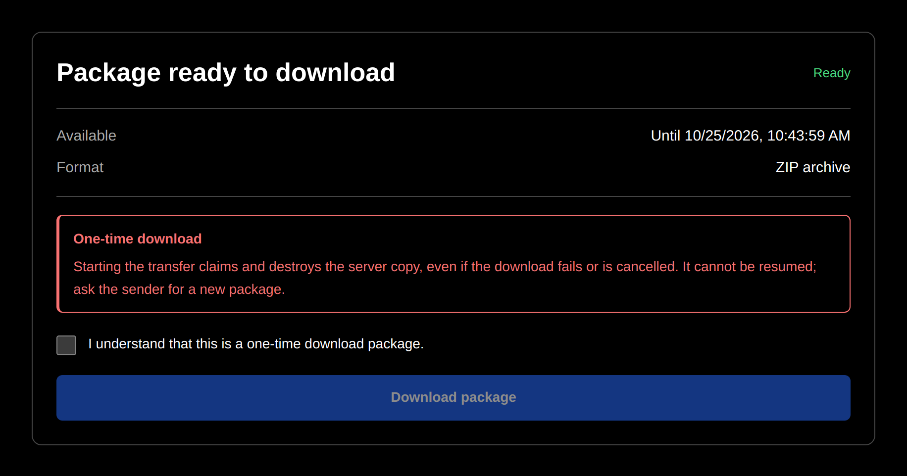
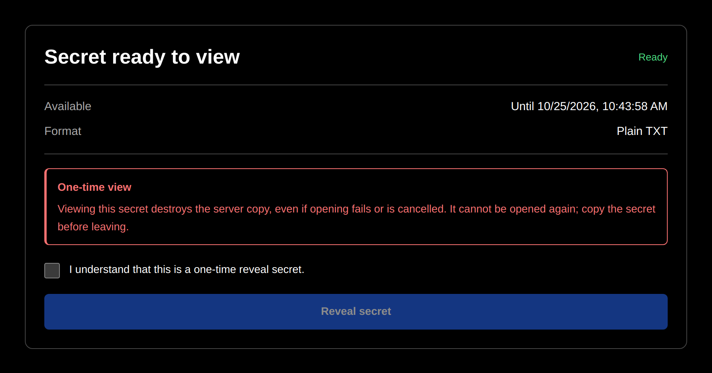
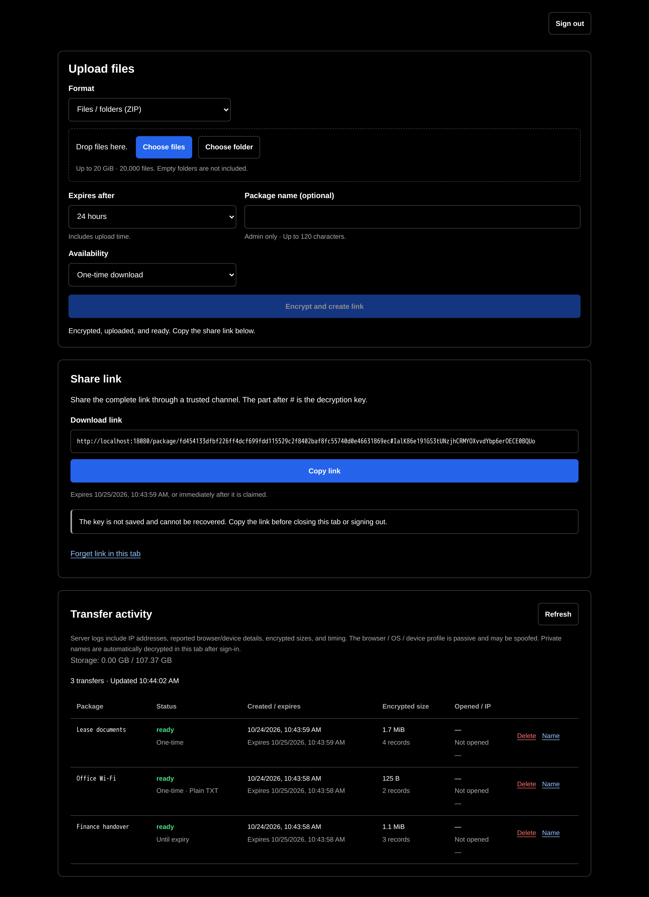

# vault.miszori.dev

A self-hosted app for sharing files, folders, and text secrets through one-time or time-limited links. Everything is encrypted and decrypted in the browser, so the server only ever stores ciphertext and never sees a key, and the admin side is reachable only through a WireGuard VPN. The code was written with AI under my direction.

| Recipient: file package | Recipient: text secret |
| --- | --- |
|  |  |

<details>
<summary>Admin: upload, share link, and transfer activity (VPN only)</summary>



</details>

[](LICENSE)


## Features

- **End-to-end encrypted sharing.** Each package gets a fresh AES-256-GCM key that travels only in the link's `#` fragment, which browsers never send to the server.
- **One-time or reusable links.** A one-time package is gone after the first authorized download or reveal; a reusable one works until it expires or you delete it.
- **Files, folders, and text.** File packages download as one ZIP archive; text secrets are revealed in the browser and never become a file.
- **Large transfers.** Up to 20 GiB and 20,000 files per package, streamed in 8 MiB chunks into a ZIP64 archive without buffering the whole file on supported browsers.
- **Private administration.** Uploads happen only over WireGuard, and package names and retrieval activity are encrypted to keys that never leave the admin's browser.
- **Safe link previews.** Messaging apps get one generic preview image, and fetching a preview never consumes a one-time package.

## Quick start

Everything runs in Docker, so you don't need Go installed. The test suite also needs Node.js 22+ and Python 3. This starts a disposable local stack that is for testing only and must never be deployed:

```bash
docker compose -p vault-test -f tests/compose.yaml up --build -d --wait
```

Open http://localhost:18081/admin and enroll an admin with the setup token from [`tests/compose.yaml`](tests/compose.yaml). Upload a file, then open the share link it gives you. Public links are served from http://localhost:18080. The tests sign in with the fixed credentials in [docs/testing.md](docs/testing.md#integration-stack), so use those if you enroll by hand before running them.

Run the tests against the stack with:

```bash
node --test tests/*.test.mjs
```

Unit tests, the WireGuard peer test, and the optional 20 GiB transfer check are in [docs/testing.md](docs/testing.md).

## How it works

```
Recipient ─► [webserver proxy] ─► [public Caddy] ─► [Go API :8080] ─► encrypted storage
Admin device ─► [WireGuard] ─► [VPN Caddy] ─────► [Go API :8081] ─┘
```

The browser encrypts the package, uploads the ciphertext, and builds the link `https://vault.miszori.dev/package/<id>#<key>`. To download, the recipient proves they hold the key with an HKDF-derived claim token, and the browser decrypts the records locally. The API serves public and admin traffic on separate listeners, and the admin listener accepts only connections from the VPN proxy.

| Directory | What |
|-----------|------|
| `cmd/vault/` | The Go API: authentication, listeners, storage, claims, audit, and backend tests. |
| `web/` | The static browser app: encryption, ZIP streaming, and browser tests. No framework or build step. |
| `wireguard/` | The VPN image, its runtime configuration, and identity tests. |
| `tests/` | The disposable Docker stack and integration tests, including a real WireGuard peer. |
| `tools/` | An optional generator for the preview image. It is not used at runtime. |
| [`docs/`](docs/) | [Architecture and encryption](docs/architecture.md), [usage](docs/usage.md), [security](docs/security.md), [deployment](docs/deployment.md), [operations](docs/operations.md), and [testing](docs/testing.md). |

## Deploying

It runs on a Linux host with Docker Compose v2 and kernel WireGuard support, behind the shared [webserver-proxy](https://github.com/gmiszori/webserver-proxy), which owns ports 80 and 443 and passes TLS through. There is no database service. The full guide, with the port table and troubleshooting, is in [docs/deployment.md](docs/deployment.md).

1. Deploy webserver-proxy first, with `VAULT_DOMAIN` set to this domain.
2. Point the domain's DNS A record at the server.
3. Open inbound TCP 80 and 443 and the WireGuard UDP port (51821 by default). Enforce this at the upstream firewall too, because Docker forwarding can bypass UFW.
4. On the server:
   ```bash
   git clone https://github.com/gmiszori/vault.miszori.dev && cd vault.miszori.dev
   cp .env.example .env && chmod 600 .env   # set the variables below
   docker compose up --build -d --wait
   ```
5. Copy the device profile to your admin device through a trusted channel and import it into WireGuard:
   ```bash
   docker compose cp wireguard:/config/peers/admin/admin.conf ./admin.conf && chmod 600 ./admin.conf
   ```
   The profile holds the device's private key. Delete the copy once it is imported.
6. Through the tunnel, open https://10.13.13.1/admin, enter the setup token, and choose a strong password. The password never leaves the browser.

To update, run `git pull --ff-only` and `docker compose up --build -d --wait`. A restart discards incomplete uploads and interrupted one-time claims; ready packages survive. If `wireguard` restarts on its own, recreate it together with `caddy-vpn`, since the proxy shares its network namespace. See [docs/operations.md](docs/operations.md) for device management and re-enrollment.

### Configuration (`.env`)

| Variable | Default | |
|----------|---------|--|
| `DOMAIN` | `vault.miszori.dev` | Public hostname. |
| `ACME_EMAIL` | | Email for certificate issuance. |
| `PUBLIC_BIND_IP` | | A specific IPv4 address on the host, never `0.0.0.0`. Behind NAT, use the LAN address. |
| `ADMIN_SETUP_TOKEN` | | One-time enrollment token of at least 32 characters, e.g. from `openssl rand -hex 32`. It is not the admin password. |
| `ADMIN_USER` | `admin` | The single administrator's username. |
| `WIREGUARD_ENDPOINT` | | Public DNS name or IP, without a scheme or port. |
| `WIREGUARD_PORT` | `51821` | Public UDP port. It must match your firewall and NAT rules. |
| `WIREGUARD_PEERS` | `admin` | Comma-separated device names, e.g. `laptop,phone`. |
| `WIREGUARD_SUBNET` | `10.13.13.0/24` | Tunnel subnet. It must not overlap Docker, host, or client networks. |
| `VPN_BIND_IP` | `10.13.13.1` | Server address inside the tunnel. |
| `MAX_STORAGE_BYTES` | `107374182400` | Ciphertext quota (100 GiB). The other admission limits are in [docs/security.md](docs/security.md#resource-controls). |

## Security

- **Keys stay in the browser.** The server stores ciphertext, encrypted manifests, and a hash of the claim token, so a copy of its disk reveals no content, file names, or links.
- **Tamper-evident chunks.** Each 8 MiB chunk is bound to its package and position, and an encrypted manifest detects missing or extra chunks.
- **Admin password never sent.** It is stretched with PBKDF2 (600,000 rounds) in the browser and split into a sign-in secret and keys that never leave it.
- **Write-only activity log.** Each retrieval's IP and browser details are encrypted to the admin's public key, so the server can't read them back.
- **VPN-only administration.** Admin routes return 404 on the public site, and the admin listener checks that the connection really comes from the VPN proxy.
- **Locked-down containers.** The API runs as a non-root user in a shell-free `scratch` image with a read-only root and dropped capabilities.
- **Limited logging.** Access logs are off, and error logs drop client IPs, User-Agents, and credentials.

Client-side encryption doesn't protect you if the server is compromised and serves modified JavaScript, so guard deployment access and review changes. A one-time package is consumed when an authorized download begins, even if delivery fails, so keep a copy of anything irreplaceable. Deleting a package doesn't erase it from SSDs, snapshots, or backups. The code has not been independently audited. The full threat model is in [docs/security.md](docs/security.md), and vulnerability reporting is in [SECURITY.md](SECURITY.md).

## License

[MIT](LICENSE)
