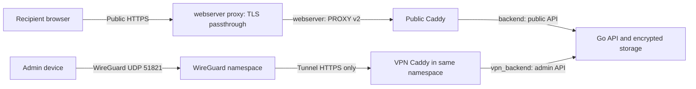

# Architecture and encryption

## Services and network isolation

[compose.yaml](../compose.yaml) defines four services:

| Service | Responsibility |
| --- | --- |
| `caddy` | Public HTTPS and ACME, recipient assets, and public API proxying via [`Caddyfile`](../Caddyfile) |
| `wireguard` | Admin-only encrypted tunnel, persistent per-device identities, and forwarding restrictions |
| `caddy-vpn` | Admin HTTPS using an internal CA; shares WireGuard's network namespace, but not its keys or configuration volume, via [`Caddyfile.vpn`](../Caddyfile.vpn) |
| `api` | One Go process managing authentication, ciphertext, package state, quotas, audit records, and cleanup |

Public Caddy joins `edge`, internal `backend`, and the external `webserver` network (alias `vault`); it cannot access the private backend, WireGuard keys, or VPN CA. WireGuard joins `vpn_ingress` and internal `vpn_backend`; the ingress bridge permits UDP port publishing. VPN Caddy binds only the tunnel IP. Both proxies share headers and upstream settings from [`Caddyfile.common`](../Caddyfile.common).

The API has separate public (`172.30.0.2:8080`) and admin (`172.30.0.130:8081`) listeners. The public handler rejects admin routes even with valid credentials. The admin handler requires the actual socket peer to equal `ADMIN_PROXY_IP` (`172.30.0.131`) as well as application authentication. Forwarded headers cannot satisfy that peer check. This is interface isolation, not process isolation against an API compromise.

Public requests to unknown hostnames or an IP address are aborted, or fail TLS negotiation. Hostname checks are not authentication.

The webserver proxy routes by SNI without decrypting, so certificates and TLS stay in public Caddy. Each connection it forwards starts with a PROXY v2 header carrying the client address. Public Caddy honors that header only from the proxy's fixed address `172.31.250.2`, so `{remote_host}`, the forwarded `X-Real-IP`, rate limits, and audit IPs remain the real client; other containers on the shared network cannot claim an address. Do not attach unrelated containers to backend networks or add a CDN/external reverse proxy without redesigning client-IP reporting and trust boundaries.

### Changing listener addresses

Change static Docker addresses, `PUBLIC_LISTEN_ADDR`, `ADMIN_LISTEN_ADDR`, `ADMIN_PROXY_IP`, both Caddy upstreams, and `TRUSTED_PROXY_CIDR` together. The trusted CIDR must be private IPv4 between `/24` and `/32`; it controls forwarded client-IP trust, not admin authorization. Avoid the multi-network `api` DNS name as an upstream because it can resolve to either interface.

Outside Compose, defaults are `127.0.0.1:8080` (public), `127.0.0.1:8081` (admin), and `127.0.0.1` (admin proxy). Wildcard and hostname listener bindings are rejected. Startup and health checks require both listeners; shutdown drains them concurrently. Connection caps apply per listener, while request and transfer admission limits are shared.

## Package lifecycle and protocol

1. **Allocation:** the server creates a random 256-bit package ID and a separate upload token. Authenticated uploads require that token; only its SHA-256 hash is persisted, then cleared at finalization.
2. **Encryption:** the browser generates a fresh random AES-256 key per package and encrypts the manifest and data records sequentially. Failed or ambiguous uploads are aborted rather than re-encrypted with reused IVs.
3. **Finalization:** the API verifies the record inventory and stores a hash of a key-derived claim proof. The browser produces `https://vault.miszori.dev/package/<package-id>#<base64url-key>` using the configured public domain.
4. **Claim:** an explicit recipient action sends a derived proof, not the decryption key. After proof validation and resource admission, the API durably records the retrieval start. A one-time claim atomically changes `ready` to `consuming`; concurrent claims cannot consume it twice.
5. **Delivery:** the response is a sequence of 4-byte big-endian ciphertext lengths followed by ciphertext records. For one-time packages, each record is unlinked before streaming, and remaining ciphertext is removed on completion or failure. Reusable packages retain ciphertext until expiry/deletion and completion of active reads.
6. **Local decoding:** the browser authenticates records and validates manifest, order, size, and paths. File data becomes a streaming ZIP/ZIP64 archive; text requires valid UTF-8 and a complete, correctly bounded stream before display.

Record 0 for files is a version-1 JSON manifest containing `files` entries (`path`, `size`, `lastModified`) and `chunkSize:8388608`. Data follows in manifest order, split into 8 MiB chunks; empty files need no data record. Text packages use exactly two records: a manifest with `version:1`, `format:"text"`, UTF-8 byte `size`, and `chunkSize:8388608`, followed by the text bytes. The server knows the format and availability mode but does not interpret encrypted contents.

Every record uses AES-256-GCM with a 128-bit tag. The 96-bit IV is four zero bytes followed by the unsigned 64-bit big-endian record index; AAD is UTF-8 `packageID:recordIndex`. Unique indices and a fresh key prevent IV reuse. ZIP CRC-32 is for archive compatibility; AES-GCM provides authentication. Unsafe traversal paths and duplicate names are rejected, and archive metadata memory is bounded by manifest/file-count limits.

Claim proofs use HKDF-SHA256 with the raw 32-byte package key, UTF-8 package ID as salt, and info `vault.miszori.dev:package-claim:v1`. The resulting 32-byte token is sent as `X-Claim-Token` on a bodyless HTTPS POST. The API stores only SHA-256 of the decoded token as `claimHash`, never exposed in public metadata. An ID, stored verifier, or invalid token cannot claim, audit, or delete a package. Legacy packages without a valid verifier or using an older claim namespace must be recreated; there is no insecure fallback.

## Administrator authentication and private names

The browser derives a 256-bit root using PBKDF2-SHA256 with 600,000 iterations and a persistent random 16-byte salt. HKDF-SHA256 separates:

- `vault.miszori.dev:admin-auth:v1`: a 32-byte authentication value sent over HTTPS; the API stores only its SHA-256 verifier in `auth.json`.
- `vault.miszori.dev:admin-names:v1`: a non-extractable AES-256-GCM key used only in the browser.
- `vault.miszori.dev:admin-audit:v1`: a non-extractable AES-256-GCM key that wraps the activity private key, used only in the browser.

Each private name uses a fresh random 12-byte IV, a 128-bit tag, and AAD `vault.miszori.dev:admin-name:v1:<package-id>`. Only version, IV, and ciphertext are stored; ciphertext length can reveal approximate name length. Authentication values do not reveal the name key, and stored verifiers cannot authenticate, but a stolen salt/verifier permits offline password guessing. Use a strong, unique password.

## Encrypted retrieval activity

Retrieval records are written when a recipient claims a link, usually while no administrator is signed in, so they cannot use a password-derived key directly. Instead, on first sign-in the browser generates a P-256 ECDH key pair and sends the API its public key plus the PKCS#8 private key encrypted with the `admin-audit` key (random 12-byte IV, AAD `vault.miszori.dev:audit-key:v1:<public-key>`). The API stores both in `audit-key.json`, accepts the key once, and can never unwrap the private key.

For each retrieval, the API generates an ephemeral P-256 key, derives an AES-256-GCM key with HKDF-SHA256 over the ECDH shared secret (salt: the ephemeral public key; info `vault.miszori.dev:audit-record:v1`), and encrypts the time, IP, and browser details with a random IV and AAD `vault.miszori.dev:audit-record:v1:<package-id>`. The plaintext is padded with JSON whitespace to whole 1 KiB blocks, so typical records are the same size and ciphertext length does not reveal the User-Agent length. Only the ephemeral public key, IV, and ciphertext are stored, in the retrieval log and as `sealedRetrieval` in `meta.json`. The admin browser decrypts them locally.

This protects stored activity, including backups and copies of the volume. The API still sees each recipient's IP and User-Agent while handling the request, so a compromised running server can record new retrievals. Retrieval counts and file modification times remain visible. Records that cannot be decrypted show as **Unavailable**.

Records written before an activity key exists stay plaintext until the next admin sign-in enrolls one. The API then rewrites each retrieval log and `meta.json` with sealed records, and retries any failed package on the 15-second sweep and at startup. Rewriting replaces the files but, as with other deletion, does not erase their old disk blocks.

Preserve `label-salt`, `auth.json`, and `audit-key.json`. The API refuses to start if `audit-key.json` is missing while sealed records exist. Losing the password makes existing private names and retrieval activity unrecoverable, not package contents, which use independent share-link keys. Names from the older separate-passphrase scheme have no migration/recovery UI and must be renamed. Sessions, passwords, keys, names, and plaintext are held in tab memory rather than browser storage.

## Persistent state

| Named volume | Contents |
| --- | --- |
| `packages` | Ciphertext, package/audit metadata, `auth.json`, `label-salt`, and `audit-key.json` |
| `caddy_data`, `caddy_config` | Public certificate and Caddy state |
| `caddy_vpn_data`, `caddy_vpn_config` | Private CA, VPN certificates, and Caddy state |
| `wireguard_config` | Server/device identities and address reservations |

Each package directory contains numbered ciphertext `.bin` files and `meta.json`: state, timestamps, the latest retrieval (sealed once an activity key is enrolled), optional encrypted name, claim verifier, byte/record counts, and the upload-token hash while uploading. Writes are synced and atomically renamed. Retrieval logs are separate from ciphertext; metadata and logs remain until 90 days after expiry.

Startup reconciles state and removes incomplete uploads, interrupted one-time claims, and revoked ciphertext before accepting requests. Ready, unexpired packages survive restarts. **Run exactly one API replica**: claim and admission locks are in-process.
